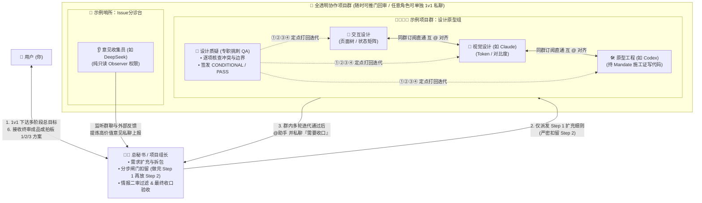

# Agents x Company

**把 Agent 从孤立的单次会话里解绑 —— 让独立开发者与小团队自由组建跨模型 AI 协作班底的团队协作底座**  
*Unbind Agents from Isolated Sessions — A Freely Programmable, Cross-Harness Multi-Agent Team Collaboration Base*

> **一句话快速体验：**  
> 🗣️ 把这个链接发给你的 Agent 之后对他说：**「部署这个仓库的方案并进行测试」**（详见 [`BOOTSTRAP.md`](./BOOTSTRAP.md)）

---

## 🌟 1. 为什么做 Agents x Company？

在日常使用 AI 推进复杂项目的过程中，我们希望帮你摆脱传统多对话与传统多子代理模式带来的精力消耗，不再让琐碎的窗口切换分散你的注意力：

1. **摆脱传统的多对话，分散你的注意力**：像使用 Codex、Claude Code 或常规聊天工具那样在左侧边栏开一排独立对话时，不同任务散落在各自的窗口里。由于人的精力有限（通常同时跟进 **3～5 个活跃对话**就会撞上注意力上限），一旦任务变多，人就不得不在十几个聊天框之间来回切换、盯进度、手动复制粘贴背景，精力很容易被窗口管理切碎。
2. **弥补传统“主代理 + 临时子代理（Main + Sub-agents）”的协作断层**：传统的临时子代理更像是“用完即毁的零工”，做完单次任务即销毁，彼此之间无法直接横向对话对齐细节，所有上下文全靠主代理在中间传话，既累又容易丢细节；一旦某个环节卡死，整条串联流水线就容易停摆。
3. **避免“全员无序拉群”变成刷屏菜市场**：如果只是简单把几个 Bot 混进同一个群里，闲聊与指令混杂、工具执行的终端脏日志满屏乱飞、谁都能越权乱改代码，没有清晰的职责与权限边界，最后反而比单聊更耗费人的精力。

### 💡 灵感来源：从 Grok Bot 的团队管理优势到跨模型自由组装

这套架构的协作理念，源于我们在深度使用 **Grok Bot** 时摸索出的一套极为顺手的团队管理优势：

1. **常驻角色与群组协同**：在 Grok Bot 的使用体验里，我们可以创建多个常驻角色——它们既能被单独私聊，也能被拉进专门的项目群里配合干活。
2. **主助手扩充需求与分步推进**：你只需要对主助手交代一句简单的想法，它就能先把需求扩充完整，再拆成一个个细小的任务去群里 `@` 不同的人干活；当你要求把两件事分成两步来做时，它就真的只先把第一部分拆解派发出去，在大家把第一步彻底做完之前绝不提前提第二部分。
3. **内部盯盘与反复打磨**：群里可以专门配一个负责挑刺和审核的角色，盯着其他成员不断迭代修改，等群内打磨完善并汇报给主助手确认完全没问题后，最后才交回给你。

但当时最大的遗憾在于：**Grok Bot 只能使用它自家的 Grok 模型。**  
而在真实的开发与设计场景里，我们往往需要使用不同厂商的强项模型各司其职——比如**自定义让擅长审美的 Claude 去当视觉与交互设计师、让工程能力强的 Codex 去写核心代码、让高性价比的 DeepSeek 去负责高频巡检与收集反馈**。

为了打破单一平台与单一模型的限制，将这套顺手的团队管理体验升级为跨宿主、跨模型通用的协作底座，我们创建了 **Agents x Company**：

1. **👩‍💼 对上极简 1v1，对下全透明玻璃房**：
   1. 你日常可以只跟顶部的 **「总秘书（助手）」**（或某几个项目组组长）1v1 交代目标；
   2. 总秘书自动将一句话想法扩充为严密规范，拆包派发进对应的 **「部门项目群」**；
   3. 左侧边栏完整陈列所有**项目群**与**专职成员**，你随时能推门进群看他们怎么交锋讨论，也能随时点开任意成员单独私聊或抽查工作台。
2. **🔒 分步闸门扣留（Stage-Gated Holding）**：
   1. 当你一次交代两步计划（例如举例中的：*“先做一套仿 PulseChat 的电脑+手机双端聊天界面；做完后再做一套 2D 游戏设计”*），总秘书**只将第一部分拆解派发进群，在第一步彻底完工前绝口不提第二部分**；
   2. 从根源上杜绝底层成员注意力稀释与需求串味，等第一阶段验收收口后再自动解锁下一阶段。
3. **🔎 双层质检闭环（群内专职「设计质疑」+ 总秘书终审收口）**：
   1. 项目群内常驻专职挑刺角色（如 **`设计质疑`**），不写业务代码，专门拿着放大镜对同僚的产出逐条挑刺（对比度是否达标、图标静态截图能否分辨、异常状态是否漏覆盖），签发 `CONDITIONAL` 并列出 `① ② ③ ④` 驱动组员在群内自发迭代至 `v1.1 / PASS`；
   2. 群内达成一致后 `@助手` 并私聊发送「需要收口」，再过总秘书最后一道把关才交付给你。
4. **🗣️ 真人研发团队级的高可读沟通**：
   1. 跑命令、读文件的脏日志全部关在成员各自的独立工作台里；
   2. 公共群内只发**人话结论 + 产物文件指针 + 章节导航（如 `看 §10 / §11`）+ 编号问题单（`① ② ③ ④`）**，让你回审时扫一眼就清清楚楚。

| 对比维度 | 传统左侧多对话窗口 (如 Codex) | 传统临时子代理 (Main + Sub-agents) | 单一平台内置群聊 (如 Grok Bot) | **Agents x Company** |
| --- | --- | --- | --- | --- |
| **交互心智负担** | 需人工在 5~10 个窗口间切换传话 | 需主代理反复中转上下文，易丢细节 | 可由主助手统筹分派 | **连续统一**：日常可只对接 1 个总入口，积压事件自动合并批处理 |
| **角色生命周期** | 散落在各个孤立会话中 | 用完即毁的临时零工，无跨轮配合 | 常驻角色，支持群聊与私聊 | **常驻角色 + 持久记忆 + 跨群灵活调配** |
| **模型选择自由度** | 取决于当前单窗口所选模型 | 通常继承或固定单一路由 | 锁死平台自家单一模型 | **跨模型自由混搭（如 Claude 做设计 + Codex 写代码 + DeepSeek 巡检）** |
| **驱动与协作方式** | 纯被动等人类逐句喂提示词 | 彼此隔离，每句话都要绕回主代理 | 支持群内 `@` 协同与审核 | **主动事件驱动 + 同群订阅直通**：同群搭档可横向直接 `@` 对齐，收敛后上报 |
| **透明度与容错性** | 完全透明，但跑长命令时前台阻塞 | 往往是黑盒日志，一处报错整链卡死 | 依赖单一平台自身稳定性 | **玻璃房体验 + 防炸接力**：随时可推门巡视或 1v1 单聊，支持独立 Fallback 链与施工证秒级换人接手 |

---

## 🎨 2. 自由编排的团队画布，而非写死的固定剧本

**Agents x Company 不预设任何强制性的岗位名称或固定流程。**  
它提供的是底层的**角色容器、群组路由、分级权限矩阵与上下文缓存引擎**——文中提到的“总秘书、设计原型群、设计质疑、意见收集员”都只是方便理解的**玩法举例**，你可以像搭积木一样，按自己的真实习惯拼出任何形态的团队：

1. **如果你喜欢极简省心托管**：你可以只设 **1 个总秘书（主助手）+ 几个专项协作群**，平时只跟总秘书一个人说话，底下怎么扩充需求、怎么拆包催进度、怎么打回重修全由它替你盯着。
2. **如果你喜欢扁平直管多个组长**：你可以不设唯一的总秘书，直接建 **几个不同方向的项目组长**分别和你对接，各自管理组内成员并行推进。
3. **如果你依然习惯像 Codex 那样逐个 1v1 单聊**：你可以平时直接点开左侧一个个拥有持久记忆的独立专家 1v1 私聊干活；遇到需要两个人对接口或多方会诊时，再随时把他们拉进同一个群里协同，不用你再当传话筒。
4. **如果你只需要跨模型智囊团头脑风暴**：你可以拉 3 个不同厂商的大模型进一个纯只读圆桌群，只做观点交锋与方案盲审，完全不开启写代码权限。

### 🏛️ 全景架构与协作闭环（以产品研发团队编排为例）



---

## ⚙️ 3. 六大底层核心机制（取长补短的通用底座）

无论你把团队结构编排成什么形状，底层都由以下六项机制保障它既聪明又不乱套：

### 「 𝟎𝟏 / 角色人格（Persona）× 模型（Model）× 规则（Rules）彻底解耦 」
每个角色都拥有独立配置的 [`RoleProfile`](./company.example.json)，岗位人设与底层算力互不绑死：

1. **独立默认模型 + 专属 Fallback 容灾链**：例如为 `视觉设计` 绑定最擅长前端审美的 `anthropic/claude-opus-5-5` 作为默认模型，当上游忙碌或异常时自动按专属 Fallback 链平滑切换至 `deepseek/deepseek-v4-flash` 等备用模型。
2. **全局规则继承开关（`inheritGlobalAgentsMd`）与专属规则共存**：可按角色单独开关是否继承宿主庞大的全局 `AGENTS.md`，同时挂载精悍的岗位专属规则（`ROLE_RULES.md`），大幅降低轻量角色的上下文噪音。
3. **默认模型与上级派单动态指定兼顾（`taskModelOverride`）**：日常情况下角色使用自带的默认模型；当总秘书或组长派发特定攻坚任务时，也可在施工证中临时指定本次任务使用的模型（任务期内锁定同一模型以保住 KV Cache，结单后自动恢复默认）。

### 「 𝟎𝟐 / 分步闸门扣留与双层收口闭环（Stage-Gated Holding） 」
为了让团队专注把眼前的事做好，顶层统筹角色支持原生的分步推进与批处理收敛策略：

1. **从一句话扩充为完整细则**：当你只给出一句简单的方向时，统筹角色会先将其补充扩充为可执行的具体方案，再拆分成细小任务 `@` 给群里不同的人。
2. **未完工前绝不提前剧透下一阶段**：当你一次交代多项有先后顺序的目标时，统筹角色只会先把第一阶段拆解派发下去，**同时将第二阶段严密扣留在顶层备忘录中**；在第一阶段彻底完工验收前绝不向执行层透露后续阶段，从根源上解决多任务并发时的注意力稀释与需求串味。
3. **群内盯盘迭代与总控双层确认**：群内专职审核角色反复检查同僚产出并驱动组内迭代；等群内达成一致汇报给统筹角色后，再由统筹角色做最后一道检查并合并积压事件，完全没问题了才交回给你。

### 「 𝟎𝟑 / 细粒度权限隔离与『收集员 → 秘书二审 → 用户拍板』情报流 」
不同角色的读写范围与发言边界单独拆分，以产品意见收集场景为例：

1. **纯只读哨兵（`read_only_observer`）**：如 `意见收集员`，只能在群内看消息、分析哪些是对产品真正有价值的意见，**无权修改代码、无权在研发群直接指手画脚**，只能整理后私聊汇报给总秘书。
2. **总秘书二次拦截与价值过滤**：总秘书收到后进行二审判断，替你拦下无价值的琐碎杂音，思考是否真的值得上报给你来立项更新。
3. **附带完善建议与可选方案呈报**：一旦决定上报给你，总秘书不仅会整理出 **「📌 源意见出处」**，还会直接附上 **「💡 秘书完善建议」** 以及 **「🔘 1 / 2 / 3 可执行方案选项」**，你点选确认后即可立项派发。

### 「 𝟎𝟒 / 分级派活与沟通拓扑矩阵（Hierarchical Dispatch Matrix） 」
拒绝无序互派，你可以自由规定“谁能分派谁、谁只能跟谁商量”，内核强制按层级校验派活范围（`dispatchScope`）：

1. **全局协调层（`company_all`）**：可跨群派活、扣留后续阶段、签发或回收施工证并做最终验收。
2. **项目群组长（`group_internal`）**：仅限在本项目群内部成员之间拆包派活、维护群内任务黑板与收口。
3. **专职质疑与质检（`group_review`）**：可对本群全部创作成员定点打回迭代或签发通过结论，只读检索并运行真实测试探针，不直接代写业务代码。
4. **同群搭档订阅直通（`peer_assist`）**：同群平级搭档之间（如前后端对接口、交互与视觉对齐）可直接互相 `@` 派活互助，无需每句话都绕回顶层中转，大幅节省中转推理次数与 Token。
5. **纯只读观察员（`report_to_secretary_only`）**：仅允许私聊总秘书呈交情报简报，严禁在研发群越界派活。

| 角色层级（可自由编排） | `dispatchScope` 权限标识 | 允许派活与 `@` 唤醒的范围 | 写文件与执行权限 |
| --- | --- | --- | --- |
| **👩‍💼 总秘书 (Chief Secretary)** | `company_all` | 全团队所有项目群、所有组长与任意专职成员 | 全局调度、扣留阶段、签发/回收施工证 |
| **🧑‍✈️ 项目组组长 (Group Lead)** | `group_internal` | 仅限本项目群内部成员拆包派活与收口 | 本项目群黑板维护与组内施工证流转 |
| **🔎 专职质疑/质检 (Critic / QA)** | `group_review` | 本项目群内全部创作成员（定点打回与放行） | 只读检索 + 运行真实测试/视觉探针 + 签发结论 |
| **🛠️ 组内专员 (交互/视觉/前后端)** | `peer_assist` | **仅限同群平级搭档之间互 `@` 互助**（如前后端对接口） | **持施工证（`Mandate`）期间解锁对应目录写权限** |
| **👂 意见收集员 (Collector)** | `report_to_secretary_only` | 仅允许私聊总秘书上报情报，禁止在研发群派活 | 纯只读（`read_only_observer`） |

### 「 𝟎𝟓 / 满血 KV Cache 命中 × 防炸施工证接力（Context-Only vs Mandate） 」
在多角色频繁互动、并发推进项目的同时，底层上下文组装机制像圆桌会议一样原生吃满提示词缓存：

1. **85%～94% 原生缓存命中**：每个常驻角色使用具名持久会话（Persistent Session），`[角色人设 + 岗位规则 + 工具定义]` 稳定前缀跨轮次 100% 字节锁定；每次唤醒角色时，未读群消息与任务变更仅作为**每轮尾部的增量入站信封（Turn Delta Envelope）**追加，超出预算的长文档只留路径引用与章节号，绝不打碎历史多轮对话的 KV Cache。
2. **闲聊参考 ≠ 施工授权（`Context-only` vs `Mandate`）**：群内日常讨论默认全部标记为 `Context-only`（纯背景参考，不触发写操作），任何角色不会因为同僚随口一句讨论就擅自去改代码；只有正式立项签发的 **施工证（`Mandate`）** 才解锁对应的文件写入权限。
3. **施工证跟事不跟人（防单点爆炸无缝接力）**：施工证绑在任务上而非锁死在固定人身上——一旦某个成员中途卡死或报错，调用 `handback`（或由总秘书、组长、自愈监控改派）即可在单事务内将施工证秒级过户给替补成员无缝接力。

### 「 𝟎𝟔 / 整套团队编制一键导出与跨宿主导入（`company.json`） 」
你精心调教好的整套团队架构可以随时打包带走或分享给社区一键复刻：

1. **零密钥纯净架构包**：所有部门群、角色人设、模型槽位、规则开关与派活权限矩阵统一收敛在单文件 [`company.example.json`](./company.example.json) 中（不含任何私密 API Key），支持一键导出分享或备份。
2. **跨宿主自动探测与绑定**：别人拿到这份配置后，直接让自己的 Agent 读取导入，对方的 Agent 会自动扫描本地软件已有的模型列表并完成角色槽位映射，一秒复刻出完全相同的团队运转起来。

---

## 🧩 4. 实战编排案例（展示你可以怎么玩，而非唯一模板）

以下三个实战案例全部基于同一套底层积木搭建，你可以直接使用、自由删改，或者完全按自己的想法从零创建：

### 案例 A：带「总秘书 + 专职挑刺员」的产品研发群（省心托管流）
适合希望**平时只跟 1 个总助手说话、把拆包和反复质检全交给团队内部完成**的场景：

1. **1v1 交代并扣留阶段**：你对 `总秘书` 说“先做一套仿 PulseChat 的双端聊天界面，做完再做 2D 游戏”。`总秘书` 只把双端界面扩充为详尽规范发进「设计原型群」，把 2D 游戏先严密扣在手里。
2. **群内平级直通与专职挑刺**：群里的 `交互设计`、`视觉设计`（绑定 Claude）、`原型工程`（绑定 Codex）各自产出后，群内常驻的专职挑刺员 `设计质疑` 自动拿着放大镜逐条审查（比如挑出“浅色主题对比度 3.63:1 不足 4.5:1”、“弱网重连状态缺失”、“390px 手机视口横向溢出”），签发 `CONDITIONAL` 并列出 `① ② ③ ④` 驱动同僚在群里迭代升版至 `v1.1`。
3. **两道筛子收口**：等群内全部改完通过，成员在群里 `@助手` 并私聊发送「需要收口」，`总秘书` 亲自复核无误后，才把干净的最终成果交回给你，并自动解锁第二阶段派发给「Godot项目群」。

### 案例 B：带「只读意见收集员 → 秘书二审」的情报过滤哨
适合独立开发者与小团队从嘈杂的外围群聊、Issue 或用户反馈里自动淘金，同时不被噪音打扰：

1. **只读哨兵聚类去重**：配置一个纯只读权限的 `意见收集员`（如绑定高性价比的 DeepSeek）盯着反馈流，将 47 条零散吐槽去重聚类，分析哪些属于真正有价值的产品痛点，整理后私聊发给 `总秘书`。
2. **秘书二审包装与一键立项**：`总秘书` 进行二次价值过滤，挡掉无价值杂音；对确有价值的痛点，整理成 **「源意见出处 + 秘书完善建议 + 1/2/3 可选执行方案」** 呈报给你，你点一下方案 `1` 即可自动转化为微任务立项派发。

### 案例 C：类 Codex 增强版「多专家 1v1 直连 + 随时拉群会诊」
适合依然喜欢**像传统 Codex 那样亲自跟各个对话窗口单聊**，但讨厌手动复制粘贴上下文的开发者：

1. **日常独立 1v1 直连**：左侧列着你的常驻后端专家、前端专家、安全审计员，你平时直接点开任意一个角色 1v1 单聊干活，各自拥有持久记忆与独立规则。
2. **按需拉群带着记忆对齐**：一旦遇到需要前后端对接口或三方会诊的问题，一键把这几个人拉进同一个群，他们直接带着刚才单聊的上下文在群里把接口对齐，不用你再在多个窗口之间当人肉传话筒。

---

## 🖥️ 5. 独立可视化工作台原型（AgentsxCo Studio UI）

为了让所有底层宿主（包括纯命令行的 Pi、Hermes、OpenCode 以及 OpenClaw、DSH）都能拥有完全一致的拟人化团队交互体验，本仓库内置了零构建依赖的高颜值 **Agents x Company Studio** 独立工作台原型：

1. **本地或在线直接打开体验**：[`docs/studio/index.html`](./docs/studio/index.html)（全功能单页自包含应用，支持本地直接双击打开，也支持通过 GitHub Pages `/docs` 直接在线访问，内置深色 / 浅色主题切换与手机端响应式抽屉）。
2. **核心视图一览**：
   1. **左侧全景导航栏**：置顶「👩‍💼 助手 · 总秘书（带金色星标）」+ 「五个项目群（设计原型 / Issue分诊台 / 部署审查 / 产品调研 / Godot项目）」+ 「部门专职成员名录」（既能进群回审，也能像传统多对话一样随时点人 1v1 单聊）；
   2. **1v1 秘书总控视图（场景 A）**：直观展示两阶段任务的**「分步闸门扣留」**状态条（可点开查看秘书扣留原文），以及**「意见收集员 → 秘书二审」**带可点击方案 `1 / 2 / 3` 的呈报卡片与一键验收解锁 Step 2 交互；
   3. **项目群玻璃房视图（场景 B）**：完整还原秘书派发双端界面设计任务、`交互设计` 交付状态图、`设计质疑` 发出 `CONDITIONAL` 四条硬核挑刺、`交互设计` 升级 `v1.1` 并 `@助手 需要收口` 的全过程（支持点击产物卡片弹窗预览 Markdown 全文）；
   4. **组织架构与右侧独立配置抽屉（场景 C）**：支持悬停任意席位实时透视 `dispatchScope` 可触达范围、查看分级派活矩阵、探测五大宿主槽位、在线导入/导出 `company.json`，以及在右侧抽屉实时调整任意角色的人格 Prompt、默认模型、Fallback 链、`继承全局 AGENTS.md` 开关、任务模型覆盖开关与 KV Cache 仪表盘。

---

## 🚀 6. 跨宿主通用架构与一句话自举部署

`Agents x Company` 采用 **「独立 Web 工作台 + 单文件 SQLite 微内核 + 薄宿主驱动器（Adapters）」** 三层解耦设计，原生兼容五大主流多模型 Agent 宿主：

| 目标宿主 (Harness) | 工具与协议接入方式 | 会话与模型绑定机制 |
| --- | --- | --- |
| **OpenClaw** | 原生 Gateway RPC / 内置工具桥 | 自动读取 `agents.entries` 与宿主模型池，支持挂载至 Control UI 侧栏 |
| **DeepSeek Harness (DSH)** | DSH Session Bridge + CLI | 复用 DSH 存算分离工单事务底座与本地已认证模型路由 |
| **OpenCode** | MCP Server + `opencode run --session` | 自动扫描 OpenCode 已配置的 Provider 列表并映射角色槽位 |
| **Pi (`pi-coding-agent`)** | `SKILL.md` + 持久会话 JSONL 驱动 | 零侵入挂载本地 `aa-room` CLI，终端跑模型推理、网页看团队多群协作 |
| **Hermes** | MCP / CLI 双通道 | 自动映射 Hermes Agent 会话池与多供应商模型路由 |

### ⚡ 一句话让你的 Agent 自动部署并测试（Agent-Native Bootstrap）

不用手动翻阅繁琐配置文档，直接**把这个链接发给你的 Agent**（OpenClaw / DSH / Pi / OpenCode / Hermes）之后对他说：

```text
部署这个仓库的方案并进行测试
```

你的 Agent 会按照根目录 [`BOOTSTRAP.md`](./BOOTSTRAP.md) 的自举协议自动完成全流程：

1. **自动获取仓库与探测宿主模型池**：自动拉取本仓库（若尚未在本地），识别当前运行在哪个宿主环境下，扫描本地已配置好的可用模型列表并生成 `.agentsxco/harness-binding.json`（无需重复填写 API Key）。
2. **导入团队架构与初始化微内核**：读取并导入 [`company.example.json`](./company.example.json)，初始化「总秘书 + 项目群 + 专职成员」本地状态库。
3. **执行端到端冒烟自测**：自动验证分步闸门扣留、只读收集员权限拦截、同群搭档订阅直通与 KV Cache 增量信封，并向你返回测试报告与本地 Studio 工作台入口。

---

## 📂 7. 仓库目录结构

```text
AgentsxCo/
├── README.md                 # 项目总览与快速指南（本文件）
├── ARCHITECTURE.md           # 跨宿主多角色团队协作核心架构蓝图 v1.0
├── BOOTSTRAP.md              # 供宿主 Agent 读取的「一句话自动部署并进行测试」自举协议
├── company.example.json      # 可自由设计、一键导入/导出的团队组织架构配置包
├── docs/                     # GitHub Pages 站点与 Studio 工作台根目录
│   ├── index.html            # 官方展示主页
│   └── studio/
│       └── index.html        # 可直接打开交互的 Agents x Company Studio 工作台原型
└── scripts/
    └── e2e-studio.mjs        # Studio 工作台与官网自动化端到端校验脚本
```
